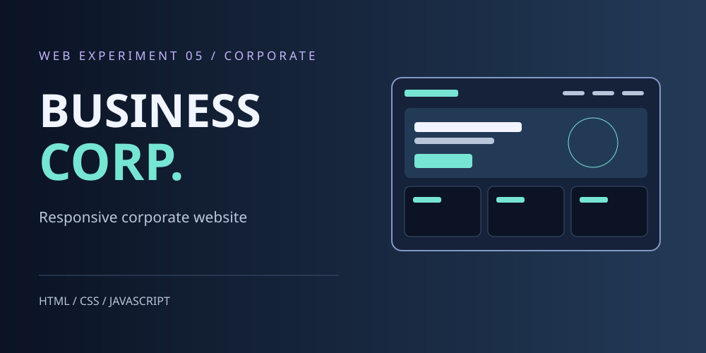

# BusinessCorp — Responsive Business Website



A fictional corporate landing page created for Web Experiment 05. The project demonstrates responsive navigation, semantic page sections, reusable component styles and basic client-side interaction.

**Status:** Academic project / implemented static frontend prototype. Browser testing and live deployment verification pending.

## Features
- Home, About, Services, Portfolio and Contact sections.
- Responsive sticky navigation with a keyboard-operable mobile menu.
- Accessible menu state, Escape dismissal and focus handling.
- Progressive enhancement: navigation is available without JavaScript.
- Responsive CSS Grid and Flexbox layouts, reusable cards and a dark corporate visual identity.
- Local enquiry preview with validation; no server, storage or network submission.
- Visible keyboard focus, skip navigation and reduced-motion support.

## Run locally

Open `index.html` or serve the root:

```bash
python -m http.server 8000
```

Visit http://localhost:8000. No installation, API key or backend required.

## Files

- `index.html` — semantic corporate landing page.
- `styles.css` — responsive components and layout.
- `script.js` — navigation behaviour and demo form validation.
- `tests/site.test.js` — regression tests for navigation state and form validation.
- `assets/cover.svg` — original concept artwork.

## Tests

With Node.js 18+:

```bash
node --test tests/site.test.js
```

Manually verify keyboard navigation, mobile and desktop widths, menu dismissal, viewport resizing, anchor navigation and form preview in a browser before deployment.

## Limitations

BusinessCorp is a fictional academic brand. Services and portfolio cards are explicitly illustrative, not real client engagements. There are no real contact details, analytics, payment services or backend. Use fictional data in the form. No public demo URL is documented until verified.

## Learning objectives

Practice responsive navigation, media queries, CSS Grid, Flexbox, semantic HTML and DOM event handling.
